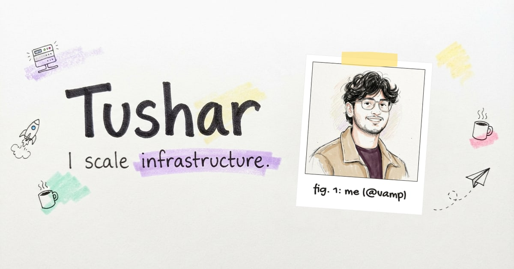

<p align="center">
  
</p>

<h1 align="center">tushar-a.dev</h1>

<p align="center">
  A personal portfolio drawn like a sketchbook: ink lines, highlighter swipes, sticky notes and taped polaroids.<br />
  Built with Astro 5 and plain CSS. No UI framework, no Tailwind, no runtime dependencies.
</p>

<p align="center">
  <a href="https://tushar-a.dev"><strong>Live site</strong></a> ·
  <a href="https://tushar-a.dev/witchly">Witchly case study</a> ·
  <a href="https://tushar-a.dev/resume">Resume</a>
</p>

---

## Highlights

- **Hand-drawn design system in ~400 lines of CSS.** Wobbly borders, sticky notes, highlighter text and self-drawing SVG scribbles, all from a handful of reusable classes.
- **Light and dark themes.** The dark mode is a "night sketchbook": the page turns charcoal with light ink, while paper objects (notes, polaroid, notebook sheet, diagram) stay paper. The theme is set before first paint, so the page never flashes.
- **Custom art pipeline.** Doodles were generated with Gemini, then sliced and converted into transparent PNGs by a small Sharp script, so the same art works on paper, on coloured notes and inverted in dark mode.
- **A hand-drawn architecture diagram** (inline SVG) explains how Witchly survived a 50 Gbps DDoS.
- **Content-driven.** Projects and the `/now` note are MDX files validated by a Zod schema. Change a file, push, and it's deployed.
- **Small and fast.** About 16 KB gzipped for the home page's HTML, CSS and JS. Images are served as WebP through `astro:assets`.

## Lighthouse

Measured on the production build with Lighthouse 12 (mobile uses simulated slow 4G).

| Page | Performance | Accessibility | Best practices | SEO |
|---|---|---|---|---|
| `/` (desktop) | 100 | 100 | 100 | 100 |
| `/` (mobile) | 99 | 100 | 100 | 100 |
| `/witchly` (mobile) | 99 | 100 | 100 | 100 |
| `/resume` (mobile) | 100 | 100 | 100 | 100 |

Total blocking time is 0 ms and layout shift is 0 on every page.

## A tour of the page

| Section | Treatment |
|---|---|
| **Hero** | "fig. 1": a taped polaroid of a hand-drawn portrait with hand-written callouts and arrows pointing at it |
| **Now** | A tilted yellow sticky note, sourced from `src/content/now/now.mdx` |
| **Experience** | "The road so far": year bubbles connected by a winding dotted path |
| **Witchly** | A two-page spread with stats and an SVG architecture sketch (frontend, control plane, data plane) |
| **Projects** | A wall of equal-size sticky notes that lift off on hover |
| **Skills** | A lined notebook page with a red margin and ticked lists |
| **Contact** | A postcard with a pixel-avatar stamp, a postmark and links on the address lines |

Other routes: `/witchly` (case study with an inline PDF), `/resume` (highlights plus an inline PDF) and a themed `/404`.

## Design system

All visual language lives in two files: `src/styles/tokens.css` (colours, fonts, shapes) and `src/styles/global.css` (primitives).

| Class | What it draws |
|---|---|
| `.sketch` | A wobbly ink box. Uneven `border-radius` plus a hard offset shadow |
| `.note` | A sticky note with a tape strip. Tilt via `--tilt`, colour via `.note-yellow` / `-mint` / `-pink` / `-violet` |
| `.hl` | A highlighter swipe behind inline text (`--hl` picks the colour) |
| `.tag` | A hand-circled monospace label |
| `.btn` | A sketched button that presses in on click |
| `.doodle` | A piece of art. Inverted automatically in dark mode |

Two small components build on top:

- **`Scribble.astro`**: an SVG underline, arrow or circle that draws itself in when its section scrolls into view.
- **`Doodle.astro`**: renders `src/assets/doodles/<name>.png` if it exists, otherwise nothing. The layout works before (and without) any art.

**Palette:** paper `#fbf8f1`, ink `#1f1d1a`, plus highlighters violet `#b9a7ff`, yellow `#ffe27a`, mint `#a6ecc9` and pink `#ffb8cc`. Text colours meet WCAG AA on paper and on every note colour.

**Type:** [Gochi Hand](https://fonts.google.com/specimen/Gochi+Hand) for headings, [Shantell Sans](https://shantellsans.com/) for body text and [JetBrains Mono](https://www.jetbrains.com/lp/mono/) for tags. All are self-hosted WOFF2 files.

## Tech stack

- **[Astro 5](https://astro.build)**: static site generation, MDX content collections, `astro:assets`
- **Vanilla CSS**: custom properties, `color-mix()`, CSS masks. No preprocessor
- **TypeScript**: strict mode, with content frontmatter validated by Zod
- **[Sharp](https://sharp.pixelplumbing.com/)**: image optimisation, the doodle slicer and the OG and favicon generators
- **Cloudflare Pages**: hosting, cache rules and security headers via `public/_headers`

Client-side JavaScript is limited to three small scripts: scroll reveals, active-section highlighting in the nav, and the theme toggle.

## Project structure

```
.
├── public/
│   ├── _headers              # Cloudflare Pages cache + security headers
│   ├── fonts/                # Gochi Hand, Shantell Sans, JetBrains Mono (WOFF2)
│   ├── Resume.pdf
│   ├── Case-Study/           # Witchly case study PDF
│   └── og.jpg                # 1200×630 social card
├── src/
│   ├── pages/                # index · witchly · resume · 404
│   ├── layouts/              # BaseLayout (meta, JSON-LD, theme bootstrap)
│   ├── components/           # Nav, Hero, NowBlock, ExperienceSection, WitchlySpread,
│   │                         # ProjectsSection, SkillsSection, ContactSection, Footer,
│   │                         # Doodle, Scribble
│   ├── content/              # MDX collections (projects/, now/) + Zod schema
│   ├── styles/               # tokens.css · global.css
│   ├── scripts/              # reveal-on-scroll
│   └── assets/
│       ├── avatar.png        # pixel-art avatar (favicon, nav, postcard stamp)
│       ├── portrait.webp     # hand-drawn portrait (hero + OG polaroid)
│       └── doodles/          # transparent doodle PNGs (generated)
├── scripts/
│   ├── slice-doodles.mjs     # raw art → transparent, trimmed doodles
│   ├── build-og.mjs          # OG image
│   ├── build-favicons.mjs    # favicons
│   └── check-links.mjs       # external link checker
└── docs/superpowers/         # design spec + implementation plan for the redesign
```

## Running locally

Requires Node 20 or newer.

```bash
npm install
npm run dev          # http://localhost:4321
```

| Command | What it does |
|---|---|
| `npm run build` | Build the static site into `dist/` |
| `npm run preview` | Serve `dist/` locally |
| `npm run check` | Type-check and validate content frontmatter |
| `npm run check:links` | Verify every external link in `dist/` (run after a build) |

`pnpm` works too; the repo declares `packageManager: pnpm@10`.

## Editing content

| What | Where |
|---|---|
| Projects | `src/content/projects/<slug>.mdx` |
| The `/now` note | `src/content/now/now.mdx` (bump `updated:`) |
| Experience and skills | The `experience` and `skillGroups` arrays in `src/pages/index.astro` |
| Hero callouts | The `callouts` array in `src/components/Hero.astro` |

A project entry looks like this:

```yaml
---
order: 6                     # position on the notes wall
title: My New Thing
tagline: One-line pitch.
description: |
  A short paragraph shown on the note.
tags: [docker, mcp, ts]      # up to 6
links:                       # at least one of internal | live | repo
  live: https://example.com
  repo: https://github.com/Vamp6969/xyz
featured: false              # the featured project gets its own spread
---
```

To give a project a doodle, add an entry to `doodleFor` in `src/components/ProjectsSection.astro`.

## Art pipeline

The doodles started as Gemini-generated images: two 3×2 icon sheets and a banner. Raw files go in `art-raw/` (gitignored), then:

```bash
node scripts/slice-doodles.mjs   # → src/assets/doodles/*.png
node scripts/build-og.mjs        # → public/og.jpg (needs Google Chrome)
```

The slicer does three things to each image:

1. Cuts each sheet into a grid, one cell per icon.
2. Treats Gemini's textured off-white "paper" as blank and turns it transparent by mathematically removing the white. Each pixel becomes ink colour plus opacity.
3. Trims each icon to its drawn area.

The result sits cleanly on any background, and the dark theme simply inverts it with a CSS filter.

The OG image is the Gemini banner with a taped polaroid of the hand-drawn portrait placed on top. Its "fig. 1" caption is lettered in Gochi Hand by headless Chrome, since Sharp can't load web fonts on its own.

## Deployment

The site deploys to Cloudflare Pages on every push to `main`.

| Setting | Value |
|---|---|
| Framework preset | Astro |
| Build command | `npm run build` |
| Output directory | `dist` |
| Environment | `NODE_VERSION=20` |

`public/_headers` caches hashed assets and fonts forever, images for a day and PDFs for 5 minutes (so resume updates go live quickly). It also sets `X-Content-Type-Options`, `Referrer-Policy`, `Permissions-Policy` and `X-Frame-Options`.

## Accessibility and SEO

- **Keyboard:** every interactive element is reachable, with a dashed focus outline.
- **Reduced motion:** `prefers-reduced-motion` turns off every animation, including scroll reveals, scribble draw-ins and note wiggles.
- **Images:** decorative doodles are hidden from screen readers. The portrait and the architecture diagram have text alternatives.
- **Structure:** one `<h1>` per page, with semantic landmarks.
- **SEO:** full Open Graph and Twitter Card meta, plus JSON-LD `Person` and `WebSite` schemas, an auto-generated sitemap, and `noindex` on the 404 page.

## Author

**Tushar A.** ([@Vamp6969](https://github.com/Vamp6969)), systems engineer and founder of [Witchly](https://witchly.host), based in Bangalore.

Say hi at <tushar@tushar-a.dev>.
